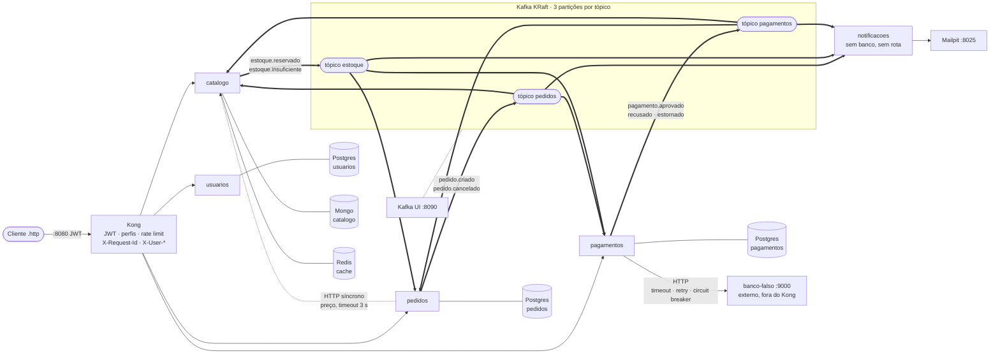

# E-commerce em microsserviços (G2)

Projeto da disciplina de Arquitetura de Sistemas (Prof. Augusto Gehrke): uma loja com cinco serviços, quatro bancos, um broker de eventos, um API Gateway e um banco de cartão externo de mentira. Uma compra passa por quase todos.

## Subir

Pré-requisito: Docker com Docker Compose. Num clone novo, **um comando**:

```bash
docker compose up -d --build
```

Sobe tudo: serviços, bancos, Kafka, Kong, Redis, Mailpit e banco-falso. Migrations, seeds e tópicos se criam sozinhos (o sistema sobe com dados), e o gateway só sobe depois que os serviços estão healthy: quando o comando termina, a loja já vende. Para conferir:

```bash
docker compose ps
```

Todos aparecem `(healthy)`. Depois, abra [`http/fluxo-completo.http`](http/fluxo-completo.http) e rode de cima para baixo (VS Code + extensão **REST Client**, "Send Request"): login, carrinho, checkout e o pedido chegando a `PAGO`, sem editar nada.

Para derrubar e **apagar os dados** (o seed roda de novo na próxima subida):

```bash
docker compose down -v
```

### Portas

| Porta | O quê | Para quê |
|-------|-------|----------|
| **8080** | Kong (gateway) | a única porta da API da loja |
| 8001 / 8002 | Admin API / Kong Manager | conferir a configuração do Kong (só em `127.0.0.1`) |
| 8090 | Kafka UI | tópicos, mensagens (envelope, chave) e o lag de cada grupo |
| 8025 | Mailpit | a caixa de entrada dos e-mails que a loja manda |
| 9000 | banco-falso | o "banco do cartão": mudar latência e falhas em `/config` |

Serviços, bancos, Redis e o Kafka **não publicam porta**: só a rede interna do compose fala com eles.

### Usuários do seed

| E-mail | Senha | Perfil |
|--------|-------|--------|
| `admin@loja.com` | `admin123` | admin |
| `cliente@loja.com` | `cliente123` | cliente (com um endereço) |

Mais 3 categorias (`celulares`, `roupas`, `livros`) e 14 produtos, com atributos diferentes por categoria e estoque (o Smartphone Fold tem só 2, para o caso "sem estoque"; um produto vem desativado). O seed é idempotente: subir de novo não duplica nada.

## Arquitetura



| Serviço | Responsabilidade | Banco | Porta interna |
|---------|------------------|-------|---------------|
| `gateway` (Kong) | rotas, JWT, perfis (acl), rate limit, `X-Request-Id`, `X-User-*` | nenhum ([`kong/kong.yml`](kong/kong.yml)) | 8000 → **8080** |
| `usuarios` | cadastro, login (**único que emite JWT**), endereços | Postgres | 3001 |
| `catalogo` | produtos, categorias, estoque; reserva e compensação; cache da vitrine | Mongo + Redis | 3002 |
| `pedidos` | carrinho, checkout, status do pedido por evento | Postgres | 3003 |
| `pagamentos` | cobra no banco do cartão; estorno; resiliência | Postgres | 3005 |
| `notificacoes` | só escuta eventos e manda e-mail | nenhum | 3004 (só `/health`) |
| `banco-falso` | o banco do cartão (sistema externo): demora, falha e recusa quando a gente manda | memória | 3000 → **9000** |
| `kafka` / `kafka-ui` | broker de eventos (KRaft, 1 broker) e o seu painel | log | 9092 / **8090** |
| `redis` | cache da vitrine, sem persistência | memória | 6379 |
| `mailpit` | servidor de e-mail de mentira | memória | 1025 / **8025** |

Cada serviço é independente: o próprio `package.json`, `Dockerfile` e banco, e nenhum importa código de outro (por isso `erros.js` e `kafka.js` aparecem copiados, de propósito).

## Rotas (todas em `http://localhost:8080`)

Acesso: **público** (nenhum plugin), **logado** (`jwt`: 401 sem token, token falso ou vencido) e **admin** (`jwt` + `acl` allow [admin]: 401 sem token, 403 perfil cliente). O Kong apaga os `X-User-*` que vêm de fora e injeta os do token; os serviços só leem `X-User-Id`, `X-User-Email` e `X-User-Role`.

### usuarios

| Método | Rota | Acesso | Retornos |
|--------|------|--------|----------|
| POST | `/auth/login` | público, **10/min por IP** | 200 `{ token, usuario }` · 400 · 401 · 429 |
| POST | `/usuarios` | público | 201 (sem a senha) · 400 · 409 e-mail repetido |
| GET · PUT | `/usuarios/me` | logado | 200 · 400 · 401 · 409 |
| GET · POST | `/usuarios/me/enderecos` | logado | 200 · 201 · 400 · 401 |
| DELETE | `/usuarios/me/enderecos/:id` | logado | 204 · 401 · 404 (não existe ou não é seu) |
| GET | `/usuarios` | admin | 200 (sem `senha_hash`) · 401 · 403 |

O token: HS256, `{ sub, email, perfil, iss: "usuarios", iat, exp }`, 2 h, perfil lido do banco no login.

### catalogo

| Método | Rota | Acesso | Retornos |
|--------|------|--------|----------|
| GET | `/produtos?categoria=&busca=` | público, **cache** | 200 (só ativos) · `X-Cache` |
| GET | `/produtos/:id` | público, **cache** | 200 · 404 · `X-Cache` |
| GET | `/categorias` | público, **cache** | 200 · `X-Cache` |
| GET | `/produtos?ids=a,b,c` | público (usado pelo checkout) | 200, ativos ou não, sem cache |
| POST | `/produtos` | admin | 201 · 400 · 401 · 403 · 409 sku repetido |
| PUT | `/produtos/:id` | admin | 200 · 400 · 401 · 403 · 404 · 409 |
| PATCH | `/produtos/:id/estoque` | admin | 200 · 400 · 401 · 403 · 404 (`{ "disponivel": 15 }` ou `{ "ajuste": -3 }`) |
| DELETE | `/produtos/:id` | admin | 204 (desativa, não apaga) · 401 · 403 · 404 |
| POST | `/categorias` | admin | 201 · 400 · 401 · 403 · 409 slug repetido |

### pedidos

| Método | Rota | Acesso | Retornos |
|--------|------|--------|----------|
| GET | `/carrinho` | logado | 200 `{ itens, total }` com os preços atuais (catálogo fora: sem preços, com `aviso`) |
| POST | `/carrinho/itens` | logado | 201 · 400 quantidade inválida · 404 produto não existe · 503 catálogo fora |
| DELETE | `/carrinho/itens/:produtoId` | logado | 204 · 404 não está no carrinho |
| POST | `/pedidos` | logado | **202** · 400 dados inválidos ou carrinho vazio · 409 produto desativado · 503 catálogo fora |
| GET | `/pedidos` | logado | 200 meus pedidos |
| GET | `/pedidos/:id` | logado | 200 com itens · 404 não existe ou não é seu |
| POST | `/pedidos/:id/cancelar` | logado | 200 · 404 · 409 (só em `AGUARDANDO_ESTOQUE` ou `AGUARDANDO_PAGAMENTO`) |

Corpos: `POST /carrinho/itens` → `{ "produtoId": "...", "quantidade": 2 }`. `POST /pedidos` → `{ "enderecoEntrega": { "cep", "logradouro", "numero", "cidade", "uf" }, "formaPagamento": "pix" | "boleto" | "cartao", "cartao": { "numero": "4111 1111 1111 1111" } }`. Do cartão, só os 4 últimos dígitos são gravados e publicados.

### pagamentos

| Método | Rota | Acesso | Retornos |
|--------|------|--------|----------|
| GET | `/pagamentos/:pedidoId` | logado (o serviço confere dono ou admin) | 200 · 401 · 404 |
| GET | `/pagamentos` | logado; o serviço exige admin | 200 · 401 · 403 |

### Saúde (público)

`GET /health/usuarios`, `/health/catalogo`, `/health/pedidos`, `/health/pagamentos` → `{ servico, status, dependencias }`. O `notificacoes` não tem rota no Kong; o `/health` dele é só para o healthcheck do Docker.

### banco-falso (`http://localhost:9000`, fora do Kong)

| Método | Rota | O quê |
|--------|------|-------|
| POST | `/cobrancas` | `{ valor, cartaoFinal, referencia }` → 201 `{ aprovado, codigo: "TX-..." }` · 402 `{ motivo: "saldo insuficiente" }` (final **0002**) · 503 (falhaPercent). A mesma referência não cobra duas vezes |
| POST | `/estornos` | `{ codigo, referencia }` → 201 · 404 nada cobrado |
| GET · POST | `/config` | `{ latenciaMs, falhaPercent }`: ver e mudar ao vivo |

### Formato de erro

```json
{ "erro": "Dados inválidos.", "detalhes": ["preco deve ser maior que zero", "sku é obrigatório"] }
```

`detalhes` só em erros de validação. Nunca stack trace, mensagem do banco ou `senha_hash`. Os 401, 403, 429 e o 404 de rota inexistente vêm do Kong: `{ "message": "..." }`.

## Eventos

Envelope igual em todos ([`kafka.js`](pedidos/src/kafka.js)): `{ id, tipo, pedidoId, ocorridoEm, correlationId, dados }`. **Chave** = id do pedido (os eventos de um pedido ficam em ordem na mesma partição). **correlationId** = o `X-Request-Id` do Kong. Tópicos com 3 partições, criados por quem sobe primeiro. Um consumer group por serviço.

| Evento | Tópico | Publica | Consome | dados |
|--------|--------|---------|---------|-------|
| `pedido.criado` | `pedidos` | pedidos (depois do COMMIT) | catalogo, notificacoes | usuarioId, clienteEmail, itens, valorTotal, formaPagamento, cartaoFinal |
| `pedido.cancelado` | `pedidos` | pedidos (cliente cancelou) | catalogo, pagamentos, notificacoes | usuarioId, clienteEmail, valorTotal, formaPagamento, cartaoFinal, motivo |
| `estoque.reservado` | `estoque` | catalogo | pedidos, pagamentos | usuarioId, clienteEmail, itens, valorTotal, formaPagamento, cartaoFinal |
| `estoque.insuficiente` | `estoque` | catalogo | pedidos, notificacoes | motivo, usuarioId, clienteEmail |
| `pagamento.aprovado` | `pagamentos` | pagamentos | pedidos, catalogo, notificacoes | usuarioId, clienteEmail, valor, codigoTransacao |
| `pagamento.recusado` | `pagamentos` | pagamentos | pedidos, catalogo, notificacoes | usuarioId, clienteEmail, valor, motivo |
| `pagamento.estornado` | `pagamentos` | pagamentos | catalogo, notificacoes | usuarioId, clienteEmail, valor, codigoTransacao |

Entrega **pelo menos uma vez**: o offset é confirmado depois do handler, então todo handler é idempotente (`reservas.pedidoId` único no catálogo, `pagamentos.pedido_id UNIQUE`, e filtro de estado em toda mudança de status).

### O pedido, do começo ao fim

```
AGUARDANDO_ESTOQUE ──estoque.reservado──> AGUARDANDO_PAGAMENTO ──pagamento.aprovado──> PAGO
   │  └──estoque.insuficiente──┐               │
   │                           ▼               │
   └──pagamento.recusado──> CANCELADO <────────┴── pagamento.recusado · cancelado pelo cliente
```

Cada seta só vale a partir do estado de origem: um evento repetido ou atrasado não leva o pedido para trás. `CANCELADO` sempre grava o `motivo`.

Entre tópicos diferentes o Kafka não garante ordem: sob carga, o `pagamento.aprovado` (tópico `pagamentos`) pode chegar ao pedidos antes do `estoque.reservado` (tópico `estoque`) do mesmo pedido. Por isso `PAGO` vale a partir de `AGUARDANDO_ESTOQUE` ou `AGUARDANDO_PAGAMENTO` (só existe pagamento depois de a reserva dar certo), e o `estoque.reservado` atrasado é ignorado. O teste de carga encontrou esse caso.

### A saga

| Passo | Serviço | Compensação | Disparada por |
|-------|---------|-------------|---------------|
| criar o pedido | pedidos | `CANCELADO` com o motivo | `estoque.insuficiente`, `pagamento.recusado` |
| reservar o estoque (tudo ou nada, `$gte`) | catalogo | devolver ao disponível (só se a reserva ainda está `reservada`) | `pagamento.recusado`, `pedido.cancelado` |
| cobrar | pagamentos | estornar (`APROVADO` → `ESTORNADO`) ou bloquear a cobrança futura (`CANCELADO`) | `pedido.cancelado` |
| confirmar a venda | catalogo | devolver o vendido (`confirmada` → `devolvida`) | `pagamento.estornado` |
| avisar | notificacoes | outro e-mail | qualquer cancelamento |

Reservar vem antes de cobrar (desfazer uma reserva é de graça; um estorno custa taxa e aparece no extrato). Estorno que falha fica gravado como `ESTORNO_PENDENTE` e é tentado de novo a cada 30 s.

## Demonstração

Os cenários estão prontos nos arquivos `.http` (todos pelo gateway):

| Arquivo | O que tem |
|---------|-----------|
| [`fluxo-completo.http`](http/fluxo-completo.http) | **a saga inteira:** login → vitrine → carrinho → checkout (202) → `PAGO` → pagamento; cartão 0002; cancelamento com estorno; cliente em rota de admin (403); cache MISS/HIT e invalidação |
| [`fluxo-compra.http`](http/fluxo-compra.http) | compra aprovada, cartão recusado e cancelada com estorno, cada uma com o pedido, o pagamento e o estoque |
| [`demos.http`](http/demos.http) | o banco-falso instável (30%), fora do ar (circuito abre) e lento (timeout), e a volta ao normal |
| [`pedidos.http`](http/pedidos.http) | carrinho e checkout em detalhe: sem estoque, pedido de outro usuário, catálogo fora (503) |
| [`usuarios.http`](http/usuarios.http) · [`catalogo.http`](http/catalogo.http) | cadastro, login, `/me`, rate limit; vitrine e gestão de admin; tentativas de se passar por admin |

O login aceita 10 tentativas por minuto por IP: rodando vários arquivos seguidos, espere um minuto entre eles se aparecer 429.

| Cenário | Como provocar | Esperado |
|---------|---------------|----------|
| Caminho feliz | pix ou cartão 4111... | `PAGO`; o produto sai do reservado (vendido); e-mails "Recebemos" e "Pagamento aprovado" |
| Sem estoque | 3 Smartphones Fold (o seed tem 2) | 202 e depois `CANCELADO`, motivo "estoque insuficiente"; nada reservado |
| Cartão recusado | cartão com final `0002` | `CANCELADO` (saldo insuficiente); o estoque volta |
| Cancelar na cobrança | `POST :9000/config { "latenciaMs": 1500 }`, checkout e cancelar | pagamento `ESTORNADO` (ou `CANCELADO`); o estoque volta |
| Banco instável | `{ "falhaPercent": 30 }` | `PAGO`, alguns com 2 ou 3 tentativas |
| **Circuit breaker** | `{ "falhaPercent": 100 }` e 2 ou 3 compras | log `CIRCUITO ABERTO`; `/health/pagamentos` com `circuitoBancoExterno: "aberto"` e `degradado` (200); as compras seguintes falham na hora; volte a `{ "falhaPercent": 0 }`: em 15 s "meio-aberto" e, na próxima compra, "fechado" |
| Banco lento | `{ "latenciaMs": 3000 }` | 3 tentativas com timeout, estorno de segurança, pagamento `ERRO`, pedido `CANCELADO` |
| Catálogo fora | `docker compose stop catalogo` | checkout 503 em até 3 s; carrinho e pedidos continuam |
| Cache | `GET /produtos` duas vezes; admin muda o preço | `X-Cache: MISS`, depois `HIT`; após a escrita, `MISS` com o preço novo |
| Redis fora | `docker compose stop redis` | a vitrine responde com `X-Cache: OFF`; `/health/catalogo` `degradado` (200) |
| Banco de um serviço fora | `docker compose stop pagamentos-db` | `/health/pagamentos` 503; em uns 30 s `docker compose ps` mostra `(unhealthy)`; volta sozinho ao subir o banco |

## Testes automatizados

Além dos `.http` (manuais), a pasta [`testes/`](testes/) tem uma suíte automática que testa o sistema **de fora, pelo gateway**, como um cliente de verdade. Ela usa o executor de testes do próprio Node (`node:test`, equivalente ao pytest) e não precisa instalar nada. Com o sistema no ar:

```bash
cd testes
node rodar.js
```

O executor espera o sistema ficar pronto e roda os arquivos em ordem, um por vez (os de infraestrutura param e religam containers). Para rodar só alguns, use `node rodar.js 04 05`.

| Arquivo | O que verifica |
|---------|----------------|
| `01-gateway` | health pelo Kong; `X-Request-Id`; 401 (sem token, token falso, assinatura falsa, perfil inexistente); `X-User-*` de fora apagado; 403 de admin; 404 do Kong; o JWT (HS256, sub, perfil, 2 h); só as portas combinadas publicadas |
| `02-usuarios` | login (mesmo 401 para senha errada e e-mail inexistente), cadastro (perfil sempre cliente, 409, 400, JSON quebrado), `/me`, endereços (404 para o endereço de outra pessoa), lista de admin sem `senha_hash`, formato de erro |
| `03-catalogo` | vitrine, filtros, busca, 404; CRUD de admin com 409 e 400; PUT não mexe no estoque; PATCH nunca negativo; DELETE desativa; **cache** MISS → HIT → invalidação na escrita |
| `04-pedidos` | carrinho, checkout 202 → `PAGO`, preço do momento do checkout, sem estoque → `CANCELADO` (tudo ou nada), produto desativado 409, pedido de outra pessoa 404, cancelar `PAGO` 409, e-mails no Mailpit |
| `05-saga` | banco-falso (402, idempotência da referência, estorno); pagamento APROVADO; cartão 0002 com estoque devolvido; cancelar no meio da cobrança → `ESTORNADO`; 30% de falha → retry; 100% → circuito abre, `degradado`, e fecha sozinho; latência 3 s → timeout, 3 tentativas |
| `06-kafka` | envelope, chave = id do pedido, mesmo `correlationId` = `X-Request-Id`, cartão fora do evento; **reentrega** de `pedido.criado` e `estoque.reservado` sem reservar nem cobrar de novo; **eventos fora de ordem** entre tópicos; um grep mostra a compra em 4 serviços; nada sensível nos logs; lag zero |
| `07-infra` | todos `(healthy)`; Redis fora → `X-Cache: OFF` e `degradado`; catálogo fora → checkout 503 em ~3 s; banco do pagamentos fora → 503 e `unhealthy`, e volta sozinho; notificações fora → a loja vende e os e-mails saem quando ela volta |
| `08-rate-limit` | 10 logins por minuto por IP, depois 429 |

**Teste de carga** (pequeno, para ver o sistema sob concorrência):

```bash
node carga.js
```

Ele faz 2.000 leituras da vitrine com 50 ao mesmo tempo, 60 compras em paralelo (6 clientes) e uma disputa de 36 pedidos por 20 unidades, e no fim confere o lag do Kafka e o health. Resultado numa máquina de desenvolvimento:

| Cenário | Resultado |
|---------|-----------|
| Vitrine (2.000 GETs, 50 simultâneos) | ~580 req/s, p50 27 ms, p95 40 ms, 0 erros, 99% `X-Cache: HIT` |
| 60 compras em paralelo | todas `PAGO`; checkout p95 62 ms; saga inteira (checkout → `PAGO`) p50 ~3,5 s; 60 pagamentos, nenhum duplicado; estoque exato |
| 36 pedidos por 20 unidades | exatamente 20 `PAGO` e 16 `CANCELADO` (estoque insuficiente); estoque final 0, nunca negativo |
| Depois | lag do Kafka zero; todos os serviços `ok` |

O teste de carga encontrou um defeito real: sob concorrência, o `pagamento.aprovado` chegava antes do `estoque.reservado` (tópicos diferentes não têm ordem entre si) e o pedido ficava preso em `AGUARDANDO_PAGAMENTO`. A correção está na seção **Eventos**, e o `06-kafka` tem um teste que reproduz o caso.

## Observabilidade

**Uma compra, cinco serviços, um id.** O Kong cria o `X-Request-Id` (e o devolve na resposta), o pedidos o copia para o `correlationId` do evento, e cada serviço que recebe o evento o repassa ao próximo. Toda linha de log de requisição e de evento (publicou, recebeu, tentativa, compensação) tem `pedido=` e `req=`:

```bash
docker compose logs -t --no-log-prefix | grep <X-Request-Id> | sort
```

```
[pedidos] pedido criado pedido=b581d710-... req=56ebee99-...
[pedidos] publicou pedido.criado topico=pedidos pedido=b581d710-... req=56ebee99-...
[catalogo] recebeu pedido.criado pedido=b581d710-... req=56ebee99-...
[catalogo] publicou estoque.reservado topico=estoque pedido=b581d710-... req=56ebee99-...
[pagamentos] tentativa 1/3: banco aprovou (TX-7D4236) pedido=b581d710-... req=56ebee99-...
[pedidos] status -> PAGO pedido=b581d710-... req=56ebee99-...
[notificacoes] e-mail enviado: "Pagamento aprovado: pedido b581d710 confirmado" pedido=b581d710-... req=56ebee99-...
```

Nada de senha, token, número de cartão ou e-mail do cliente nos logs, e o `/health` fica fora deles.

**Health.** `{ servico, status, dependencias }`, testando de verdade (`SELECT 1`, Kafka, `PING` no Redis, SMTP):

| status | Quando | HTTP |
|--------|--------|------|
| `ok` | tudo funcionando | 200 |
| `degradado` | funciona, mas pior: Redis fora (catálogo), circuito do banco aberto (pagamentos), SMTP fora (notificações) | 200 |
| `fora do ar` | falta o essencial: o próprio banco ou o Kafka | 503 |

No compose, todo serviço tem `healthcheck` (`wget` no `/health`, a cada 10 s, 3 tentativas, `start_period`), e quem depende de banco e Kafka só sobe com eles healthy.

**O que vigiar:** respostas 5xx no Kong, pagamentos em `ERRO`, o estado do circuito, e o **lag** dos consumer groups no Kafka UI (lag crescendo = consumidor caído ou sem dar conta).

**Cache.** Cache-aside no Redis em `GET /produtos`, `/produtos/:id` e `/categorias`, TTL de 60 s, chave com versão (`catalogo:v<n>:...`). Toda escrita de produto, categoria ou estoque (inclusive reserva e devolução por evento) faz `INCR catalogo:versao`. `X-Cache: HIT | MISS | OFF`. O checkout não usa o cache: o preço é sempre o atual.

## Estrutura

```
.
├── docker-compose.yml        # tudo: 15 containers, healthchecks, só as portas da tabela acima
├── kong/kong.yml             # gateway declarativo: services, routes, consumers, plugins
├── http/                     # requisições para o REST Client, todas pelo gateway
├── docs/adr/                 # decisões de arquitetura, uma por arquivo
├── testes/                   # testes automatizados (node rodar.js) e de carga (node carga.js)
├── usuarios/                 # Postgres · migrations/ · seeds/ · src/
├── catalogo/                 # Mongo + Redis · src/estoque.js (reserva e compensações) · src/cache.js
├── pedidos/                  # Postgres · src/eventos.js (status por evento) · src/catalogo.js (HTTP, timeout)
├── pagamentos/               # Postgres · src/banco.js (timeout, retry, circuit breaker) · src/saga.js
├── notificacoes/             # sem banco · src/emails.js
└── banco-falso/              # o banco do cartão de mentira
```

### Variáveis de ambiente

Todas têm valor padrão no compose: nenhum `.env` é necessário. As principais:

| Variável | Onde | Padrão |
|----------|------|--------|
| `JWT_SECRET` | usuarios (assina) e gateway (confere) | `troque-este-segredo-em-producao` |
| `JWT_EXPIRES_IN` | usuarios | `2h` |
| `CATALOGO_TIMEOUT_MS` | pedidos | `3000` |
| `BANCO_URL` / `BANCO_TIMEOUT_MS` | pagamentos | `http://banco-falso:3000` / `2000` |
| `REDIS_URL` / `CACHE_TTL_SEGUNDOS` | catalogo | `redis://redis:6379` / `60` |
| `KAFKA_BROKERS` | todos com eventos | `kafka:9092` |

Para outro segredo, crie um `.env` na raiz com `JWT_SECRET=...` (está no `.gitignore`). Para entrar num banco: `docker compose exec pedidos-db psql -U pedidos` (o mesmo para `usuarios-db` e `pagamentos-db`) ou `docker compose exec catalogo-db mongosh catalogo`.

## Decisões

Em [`docs/adr/`](docs/adr/README.md), uma por arquivo, com contexto, decisão e o que se ganhou e perdeu:

| ADR | Decisão |
|-----|---------|
| [001](docs/adr/001-um-banco-por-servico.md) | Um banco por serviço (Postgres, Mongo, Postgres, Postgres) |
| [002](docs/adr/002-node-express-sem-orm.md) | Node.js + Express, sem ORM |
| [003](docs/adr/003-migrations-e-seed-na-subida.md) | Migrations, seed e tópicos criados na subida |
| [004](docs/adr/004-delete-de-produto-desativa.md) | DELETE de produto desativa |
| [005](docs/adr/005-kong-sem-banco.md) | Kong sem banco como API Gateway |
| [006](docs/adr/006-consumers-por-perfil.md) | Consumers por perfil, não por pessoa |
| [007](docs/adr/007-identidade-por-x-user.md) | Identidade por X-User-*, JWT emitido só pelo usuarios |
| [008](docs/adr/008-checkout-sincrono-so-para-o-preco.md) | Checkout síncrono só para o preço, com timeout |
| [009](docs/adr/009-kafka-e-coreografia.md) | Kafka e coreografia para o que pode esperar |
| [010](docs/adr/010-pedido-copia-preco-e-endereco.md) | O pedido copia preço, nome e endereço |
| [011](docs/adr/011-saga-por-coreografia-cancelar-quando-o-banco-cai.md) | Saga por coreografia; cancelar quando o banco cai |
| [012](docs/adr/012-resiliencia-no-pagamentos.md) | Timeout, retry e circuit breaker só no pagamentos → banco |
| [013](docs/adr/013-cache-na-vitrine-com-versao.md) | Cache-aside no Redis só na vitrine, invalidado por versão |
| [014](docs/adr/014-health-com-tres-estados.md) | Health com três estados e healthcheck no compose |

## Limitações conhecidas

- **Escrita dupla (sem Outbox):** o pedido é gravado e o evento publicado depois do COMMIT. Se o Kafka cair entre os dois, o pedido fica parado em `AGUARDANDO_ESTOQUE`. O certo seria gravar o evento numa tabela na mesma transação e publicar depois.
- **Sem DLQ:** um handler que falha é tentado 5 vezes com espera crescente; depois o erro é logado e o offset avança. Um evento que chegou com o banco do serviço fora por mais tempo que isso se perde (o pedido fica parado). O certo: um tópico de erros para reprocessar.
- **Cancelar quando o banco do cartão cai:** perde vendas que dariam certo minutos depois. A alternativa (pagamento pendente e pausar o consumo com o circuito aberto, com prazo) não foi feita.
- **Reservas sem validade:** o estoque fica reservado enquanto o pagamento não termina.
- **Um circuito por réplica:** com várias réplicas de pagamentos, cada uma tem o seu circuit breaker em memória.
- **Estorno pendente só no banco:** `ESTORNO_PENDENTE` é tentado de novo, mas ninguém é alertado; não há rotina de conciliação com o banco.
- **E-mail repetido:** pelo menos uma vez também vale para os e-mails; um evento reprocessado pode mandar o mesmo e-mail duas vezes.
- **Um broker Kafka, fator de replicação 1, um Kong:** ótimo para aprender, inaceitável em produção.
- **Health único:** sem separar liveness de readiness; o Docker só marca `unhealthy`, não tira do balanceamento.
- **Sem métricas e traces de verdade:** os logs correlacionados fazem o papel de um trace; Prometheus, Grafana e OpenTelemetry ficam fora.
- **Cache esfria a cada reserva:** toda mudança de estoque invalida a vitrine inteira.

## Histórico (tags)

| Tag | Aula | O que entrou |
|-----|------|--------------|
| `aula-gateway-pedidos` | 7 | Kong sem banco, rotas fechadas, serviço pedidos |
| `aula-kafka` | 8 | Kafka, checkout por evento, reserva, notificações |
| `aula-saga` | 9 | pagamentos, banco-falso, saga e resiliência |
| `entrega-final` | 10 | health, healthcheck, logs, cache, documentação |
